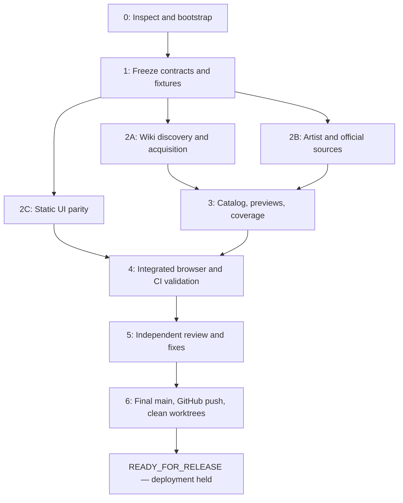

# Product and implementation plan

## Scope and decisions

Build the Dynamix counterpart of the DEEMO archive inspected at `b14bf0d5f5a05e5382c319f3fd5019a4936820b8`. “Exactly similar” means feature and workflow parity: static slideshow and searchable archive; original file downloads; transparent provenance; localized interface and docs; repeatable acquisition/build/checks; and a GitHub-ready site. It does not require copying DEEMO media, catalog entries, song-specific mappings, or its automatic deployment setting.

User-confirmed game scope is **original Dynamix only**, including free/premium songs, packs, event/rerun tracks, removed/historical artwork, and documented alternate artwork. Discover character, pack, promotional, store, process, and reference assets, but categorize them separately from song jackets. Retain small genuine source originals when no larger copy is available, with explicit size labels. Do not silently discard the only known version because it fails a size threshold.

Dynamix Universe is excluded. Record it during discovery to prevent cross-game contamination; original-game listings must have positive game evidence. A work confirmed for both may be included because of its original-Dynamix association, retaining both source associations without adding Universe to the coverage denominator. The user explicitly confirmed this scope during planning.

“All available sources” is an ongoing acquisition process, not a finite guarantee. Every known source must receive a disposition; all pages/continuations in accessible in-scope inventories must be processed; and every candidate must be downloaded, excluded with reason, failed, blocked, or pending with explanation. Use the dated source inventory and a coverage report to show the boundary of the claim.

## Product acceptance

1. `index.html` reproduces the DEEMO slideshow interaction pattern with Dynamix assets; `archive.html` provides search, source/type/size filtering and stable links between both pages. Keep game identity internally; no one-option game filter is needed.
2. Detail view shows source pages and direct file URLs, separate illustrator/composer credits, original dimensions/format/bytes/SHA-256, quality labels, alternate versions, and unknown fields honestly.
3. English and Simplified Chinese UI, README, source documentation, and attribution documents stay in sync. URL/localStorage language behavior and offline `file://` browsing match the reference.
4. Original downloads remain byte-identical; small local previews handle the grid. No external requests are needed for normal browsing. No analytics, remote fonts, or unrelated audio.
5. Fetchers can enumerate, download, resume, verify, and report failures without hiding removals, source changes, or incomplete discovery. Builds consume committed manifests and run offline.
6. Automated tests, browser checks, source accounting, packaging size checks, and independent code/data review pass on the integrated commit.
7. Final `main` is pushed to the verified GitHub project; the task's temporary branches/worktrees are removed safely; Pages deployment, tags, and GitHub Releases remain held.

## Milestones and dependency graph

| Milestone | Work and evidence | Exit condition |
| --- | --- | --- |
| 0 — inspect/bootstrap | Read project instructions/status; verify reference SHA; identify active agents and destination owner; initialize only if still empty/non-Git; commit planning files deliberately | Recorded base SHA, ownership ledger, no overwritten work |
| 1 — contract freeze | Agree schema, CLI contract, UI fixture, source IDs, path ownership; selectively reuse DEEMO utilities and license notices; capture reference desktop/mobile screenshots using local serving | Tiny deterministic fixture builds; all workers agree to one schema version |
| 2 — parallel implementation | Wiki adapters; artist/official/archive adapters; static gallery/slideshow | Each branch reviewed against its fixture tests; real-source sample proves acquisition before full enumeration |
| 3 — corpus/integration | Finish accessible enumeration and downloads; exact-byte dedup; metadata mapping; previews; coverage; bilingual source notes | All discovered candidates accounted for, failures visible, catalog deterministically rebuilt |
| 4 — CI/package | Unit and browser suite; tracked-file staging; size and hash checks; release hold tests; manual read-only source-diff workflow | Offline checks pass on merged data and UI; release artifact prepared without deployment |
| 5 — independent review | Code review, content/provenance sample audit, security and browser review; fix findings on scoped branches | No unresolved blocking findings; all material limitations documented |
| 6 — publish/clean | Fast-forward main; push verified destination; verify remote SHA/CI; remove only clean merged task worktrees/branches | Clean main; remote main equals reviewed SHA; evidence report; hold confirmed |

Execute small independently checkable subtasks within each milestone. Do not assign arbitrary promises about hours or image counts; measure source counts and bytes after inventory. Bounded network failures may leave documented collection gaps; an inaccessible source does not excuse skipping accessible adapters or fabricating completeness.

## Source priority and completion

Start with Miraheze and Fandom API metadata, cross-check original-game song lists in the Japanese wiki, then pursue illustrator-owned originals from credits. Official stores/social/press and composer-owned pages supplement this. BWIKI, other language wikis, historical snapshots, GitHub mirrors, and repost sites are secondary discovery leads with explicit access and provenance checks.

For each in-scope song without a confirmed artist/official original or a recorded completed primary-source search disposition, search exact title plus illustrator alias in English/Japanese/Chinese and any documented Korean alias. A wiki's `site_original` download does not finish this search. Preserve exact spelling and Unicode; resolve aliases through evidence, not fuzzy matching alone. Check artist portfolios and official posts before accepting a repost as the best available source. Stop repetitive queries when they produce no new sources; record the query/date/outcome and the unresolved gap.

Quality targets are relative to verified source offerings. Define `site_original` separately from `artist_master_confirmed`; dimensions and pixel area are sortable measurements, not proof of authenticity. Keep distinct crops, aspect ratios, revisions, and watermark variants. Never create a higher-resolution claim by enlarging an image.

## Size decision before bulk import

Run a metadata-only inventory and estimate actual original+preview bytes before committing the corpus. Prefer ordinary Git and the DEEMO-style static payload when it fits. Set the same conservative site budget of **950,000,000 bytes**. GitHub documents a 1 GB Pages site limit and rejects ordinary Git files larger than 100 MiB. ([Pages limits](https://docs.github.com/en/pages/getting-started-with-github-pages/github-pages-limits), [large-file limits](https://docs.github.com/en/repositories/working-with-files/managing-large-files/about-large-files-on-github))

If the complete verified collection exceeds these bounds, do not downsample originals or quietly drop sources to pass. Measure the overage, retain the full inventory, and design an explicit full-archive storage versus site-payload split. Changes requiring external paid storage, LFS billing, or release attachments need a concrete user decision; release attachments also remain under the release hold. Resolve this early, before committing oversized binaries. A collection exceeding the delivery budget is not READY_FOR_RELEASE until its distribution plan is resolved.
